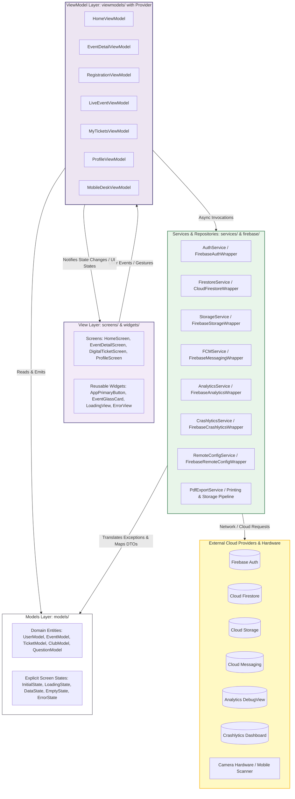
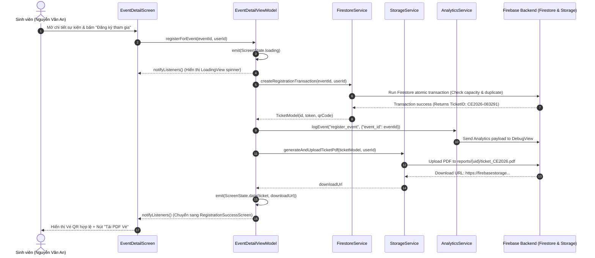

# PRM393 — LAB 3: ARCHITECTURE & MVVM SPECIFICATION
**Project:** Campus Event — FPT University HCMC  
**Student:** Lê Quốc Khánh (Product Designer & Mobile Software Architect)  
**Document:** `docs/architecture.md`  
**Standard Reference:** PRM393 Lab 3 Handout Section 5 & Rubric Section 10

---

## 1. Directory Structure

```
lib/
├── firebase/          # Firebase low-level wrappers and service initializers
├── models/            # Immutable domain entities, data classes, and sealed state models
├── services/          # Abstract contracts and concrete implementations for data/network/SDKs
├── viewmodels/        # MVVM ChangeNotifier ViewModels managing UI state and business logic
├── screens/           # Top-level screen destinations and sub-views organized by feature
├── widgets/           # Reusable Design System components with full state variants
├── theme/             # Design Tokens mapped to ThemeData (Colors, Typography, Spacing, Radius)
└── utils/             # Helper formatters, date utilities, validators, and constants
```

---

## 2. Layer Diagram (MVVM Architecture)



---

## 3. End-to-End Sequence Diagram: Event Search, Registration & PDF Export



---

## 4. ViewModel to Services Injection Matrix

| ViewModel | File Location | Injected Services Used | Primary Responsibilities & Business Logic |
| :--- | :--- | :--- | :--- |
| **AuthViewModel** | `lib/viewmodels/auth_viewmodel.dart` | `AuthService`, `AnalyticsService`, `CrashlyticsService` | User authentication status, Google Sign-In orchestration, session purge on logout |
| **HomeViewModel** | `lib/viewmodels/home_viewmodel.dart` | `FirestoreService`, `RemoteConfigService`, `AnalyticsService` | Fetch featured & upcoming events, apply `max_featured_events` threshold from Remote Config |
| **ExploreViewModel** | `lib/viewmodels/explore_viewmodel.dart`| `FirestoreService`, `AnalyticsService` | Real-time category filtering (Tech, Sports, Club, Workshop), search keyword matching |
| **EventDetailViewModel**| `lib/viewmodels/event_detail_vm.dart` | `FirestoreService`, `AnalyticsService`, `CrashlyticsService` | Load full event specs, speaker profiles, validate registration eligibility (`BR-001..004`) |
| **RegistrationViewModel**| `lib/viewmodels/registration_vm.dart` | `FirestoreService`, `StorageService`, `AnalyticsService` | Execute 1-Tap registration, ticket generation with dynamic token, upload PDF certificate |
| **MyTicketsViewModel** | `lib/viewmodels/my_tickets_vm.dart` | `FirestoreService`, `CrashlyticsService` | User ticket ledger (Upcoming, Checked-in, Expired), offline cache persistence |
| **LiveEventViewModel** | `lib/viewmodels/live_event_vm.dart` | `FirestoreService`, `AnalyticsService` | Realtime listener on live agenda, submit speaker questions, atomic upvoting |
| **FeedbackViewModel** | `lib/viewmodels/feedback_vm.dart` | `FirestoreService`, `StorageService`, `AnalyticsService` | Validate 5-star ratings, submit feedback reviews, grant FPTU Activity Points (`+5 ĐRL`) |
| **ProfileViewModel** | `lib/viewmodels/profile_viewmodel.dart`| `AuthService`, `StorageService`, `RemoteConfigService`, `CrashlyticsService`, `FCMService` | Manage student profile, host **Firebase Demo Area** (FCM notifications, test crash, export PDF, remote config toggles) |
| **MobileDeskViewModel** | `lib/viewmodels/mobile_desk_vm.dart` | `FirestoreService`, `CrashlyticsService`, `AnalyticsService` | High-speed QR token validation, detect duplicate scans, manual Ticket ID fallback, live gate counter |

---

## 5. Architectural Compliance & Strict Grading Rules

1. **Strict Dependency Decoupling:**
   - No widget in `lib/screens/` or `lib/widgets/` imports or references `http`, `FirebaseAuth`, `FirebaseFirestore`, `FirebaseStorage`, `FirebaseMessaging`, `FirebaseAnalytics`, or `FirebaseCrashlytics`.
   - All cloud SDK calls are encapsulated strictly within `lib/services/` and `lib/firebase/`.
2. **Explicit Screen State Modeling:**
   - Every data-driven screen binds to a dedicated state model:
     ```dart
     sealed class ScreenState<T> {
       const ScreenState();
     }
     class StateInitial<T> extends ScreenState<T> { const StateInitial(); }
     class StateLoading<T> extends ScreenState<T> { const StateLoading(); }
     class StateData<T> extends ScreenState<T> { final T data; const StateData(this.data); }
     class StateEmpty<T> extends ScreenState<T> { final String message; const StateEmpty(this.message); }
     class StateError<T> extends ScreenState<T> { final String error; const StateError(this.error); }
     ```
3. **Dependency Injection & Testability:**
   - All ViewModels receive their service dependencies via constructor injection. In production, dependencies are supplied via `MultiProvider` in `lib/main.dart`; in automated tests, fake/mock services are injected without touching real network sockets.
4. **Business Logic Isolation:**
   - All filtering, data aggregation, eligibility checks, and form validations are implemented inside ViewModels or Services, ensuring `build()` methods in widgets remain strictly declarative and side-effect free.
