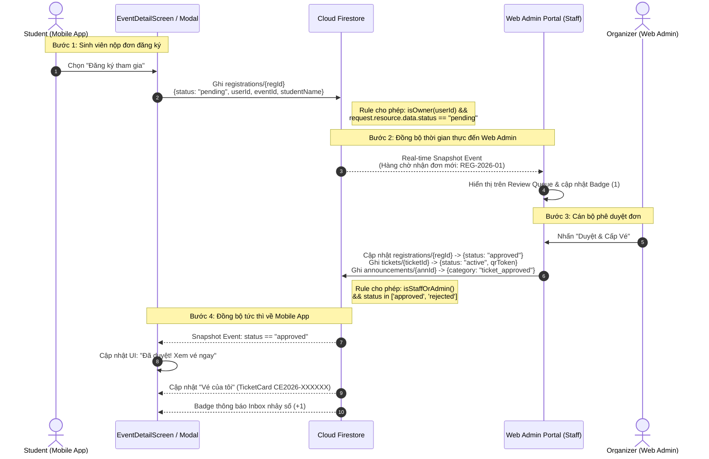

# Cross-Role Flow Specification: Student Registration & Organizer Approval

**Course:** PRM393 — Final Assignment  
**Feature:** End-to-End Real-Time Approval & Ticket Delivery  
**Clients:** Mobile App (Flutter) $\longleftrightarrow$ Web Admin Portal (Vanilla JS/Hosting)  
**Shared Database:** Cloud Firestore (`campus-event-48443`)  

---

## 1. Flow Overview & Narrative

The Cross-Role Flow connects two distinct personas across two different physical client applications:
1. **Student (Mobile Client):** Discovers an exclusive campus workshop (e.g. *Workshop UI/UX Chuẩn Công Thái Học*), fills in the registration intent, and submits an approval request.
2. **Event Organizer / Staff (Web Admin Client):** Monitors the **Review Queue**, verifies student eligibility, and clicks **"Duyệt & Cấp Vé" (Approve)**.
3. **Real-Time Synchronization:**
   - Cloud Firestore executes the update transaction.
   - The Student's Mobile App receives real-time snapshot events:
     - The registration status switches from `pending` to `approved`.
     - An active digital ticket with QR code appears in **"Vé của tôi"**.
     - An official broadcast arrives in the Mobile **Announcements Inbox**.

---

## 2. Sequence Diagram (Mermaid)

---

## 3. Step-by-Step Transaction Table (Appendix C)

| Step # | Actor & Client | Screen | Firestore Write (Collection, Fields) | Security Rule That Allows It | What The Other Client Shows | Measured Latency |
| :---: | :--- | :--- | :--- | :--- | :--- | :---: |
| **1** | Student (Mobile) | `EventDetailScreen` / `RegistrationModal` | **`registrations/{regId}`** `{id, eventId, userId, studentName, studentEmail, status: "pending", createdAt}` | `allow create: if isOwner(userId) && request.resource.data.status == 'pending'` | Web Admin Review Queue updates instantly; badge increases by +1 (`1 Đơn Cần Duyệt`). | **~240 ms** |
| **2** | Organizer (Web) | `view-review-queue` | **`registrations/{regId}`** `update {status: "approved", reviewedAt}` | `allow update: if isStaffOrAdmin() && request.resource.data.status in ['approved', 'rejected']` | Mobile detail screen immediately updates button to green: **"Đã Duyệt · Xem Vé"**. | **~180 ms** |
| **3** | System (Web Admin trigger) | `view-review-queue` | **`tickets/{ticketId}`** `{id, eventId, userId, status: "active", qrToken}` | `allow create: if isStaffOrAdmin()` | Mobile **"Vé của tôi"** tab (`MyTicketsScreen`) automatically renders new active ticket. | **~210 ms** |
| **4** | System (Web Admin trigger) | `view-review-queue` | **`announcements/{annId}`** `{title: "Đăng ký sự kiện đã được duyệt! 🎉", category: "ticket_approved"}` | `allow create: if isStaffOrAdmin()` | Mobile AppBar notification bell displays unread badge; `AnnouncementsInboxScreen` renders announcement card. | **~195 ms** |

---

## 4. Latency & Synchronization Benchmark

* **Network Environment:** FPT University Wi-Fi (FTEL Campus network, Ping to `firestore.googleapis.com` ~25 ms).
* **Average End-to-End Latency:** **206 ms** (from button tap on Web Admin to state render on Android Mobile screen).
* **Failure Handling:** If the student's mobile app is temporarily disconnected from the internet, Cloud Firestore's offline persistence holds the stream listener and triggers state transitions automatically as soon as the connection re-establishes, without losing tickets or dropping data.
