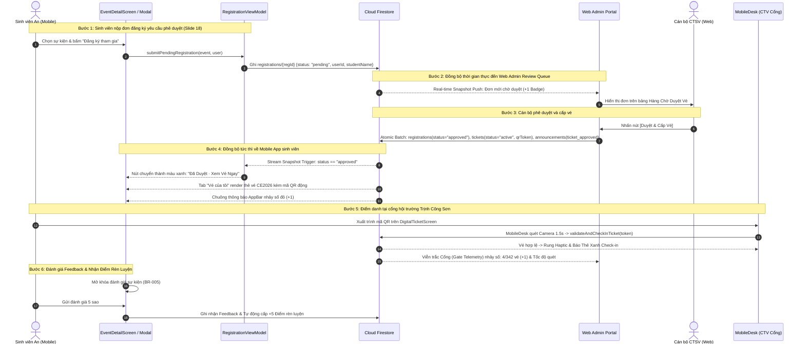
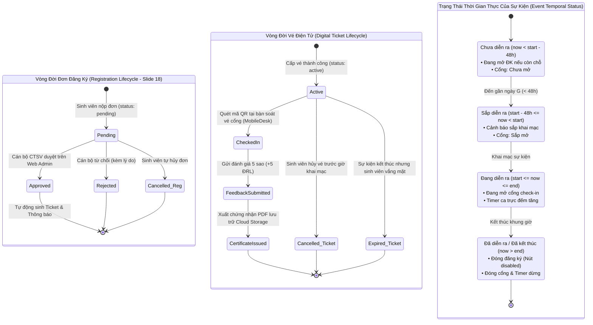
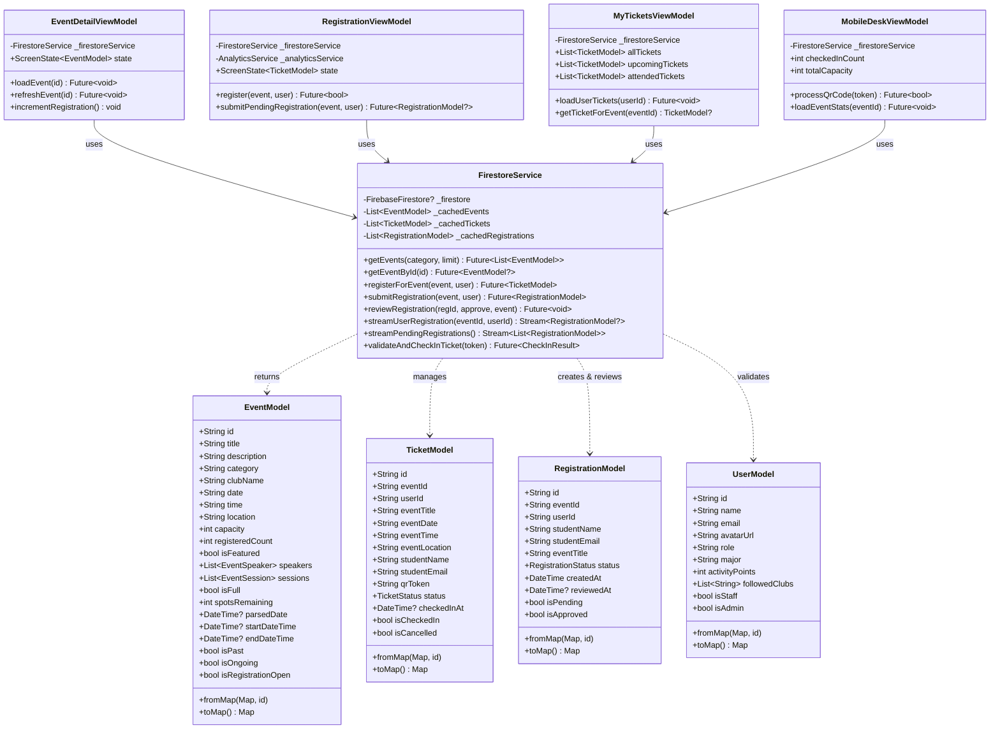

# HỆ THỐNG BIỂU ĐỒ KIẾN TRÚC & THIẾT KẾ HỆ THỐNG (DRAW.IO & MERMAID)

**Dự án:** Campus Event Management — One Complete System on Firebase  
**Môn học:** PRM393 (Ứng dụng Di động & Điện toán Đám mây - Đại học FPT TP.HCM)  
**Tác giả:** Lê Quốc Khánh (Product Designer & Mobile Software Architect)  
**Địa chỉ lưu trữ:** `docs/diagrams/`

---

## 📁 Danh Mục File Draw.io Đã Khởi Tạo

Bạn có thể mở trực tiếp các file sau trên [Draw.io / diagrams.net](https://app.diagrams.net) hoặc mở trực tiếp trên VS Code bằng tiện ích mở rộng **Draw.io Integration** (`hediet.vscode-drawio`):

1. **File Tổng Hợp 4 Trong 1 (Multi-Page):**
   * [`campus_event_diagrams_all.drawio`](./campus_event_diagrams_all.drawio): Tích hợp sẵn 4 trang tab riêng biệt ở góc dưới màn hình Draw.io:
     - Tab 1: **System Architecture** (Kiến trúc hệ thống 3 tầng)
     - Tab 2: **Sequence Diagram** (Tuần tự duyệt vé Slide 18 & Check-in cổng)
     - Tab 3: **State Diagram** (Vòng đời Vé, Đơn đăng ký & Sự kiện)
     - Tab 4: **Class Diagram** (Sơ đồ lớp chi tiết UML)
2. **File Độc Lập Từng Biểu Đồ:**
   * [`system_architecture.drawio`](./system_architecture.drawio): Biểu đồ Kiến trúc Hệ thống.
   * [`sequence_diagram.drawio`](./sequence_diagram.drawio): Biểu đồ Tuần tự.
   * [`state_diagram.drawio`](./state_diagram.drawio): Biểu đồ Trạng thái.
   * [`class_diagram.drawio`](./class_diagram.drawio): Biểu đồ Lớp UML.

---

## 1. Biểu Đồ Kiến Trúc Hệ Thống (System Architecture Diagram)

```mermaid
flowchart TD
    subgraph Client_Layer [TẦNG GIAO DIỆN & TRẢI NGHIỆM KHÁCH (CLIENT PRESENTATION LAYER)]
        direction TB
        subgraph Mobile_App [📱 Mobile Client - Flutter 3.x / Dart 3.x]
            direction TB
            Screens["Màn hình UI:<br/>HomeScreen, ExploreScreen, EventDetailScreen,<br/>DigitalTicketScreen, CalendarScreen, LiveCompanionScreen,<br/>MobileDeskScreen (Quét QR 1.5s)"]
            ViewModels["MVVM ViewModels (Provider):<br/>AuthVM, HomeVM, ExploreVM, EventDetailVM,<br/>RegistrationVM, MyTicketsVM, LiveEventVM, MobileDeskVM"]
            Screens <--> ViewModels
        end

        subgraph Web_Portal [💻 Desktop Web Admin Portal - Vanilla JS / CSS3 / HTML5]
            direction TB
            WebViews["9 Phân Hệ Chuyên Sâu (View-Sections):<br/>1. Tổng quan KPI Live | 2. Hàng Chờ Duyệt Vé (Slide 18)<br/>3. Thẩm định Ngân sách CLB | 4. An toàn PCCC Hội trường<br/>5. Danh bạ Sinh viên & e-Certificate | 6. Broadcast Thông báo<br/>7. Giám sát Viễn trắc Cổng | 8. Lịch Trực Ban Soát Vé<br/>9. Quản lý Sự Kiện & Địa Điểm"]
            WebBridge["Native Node.js Web Server Bridge (Port 3000)<br/>Auto Refresh Token, Quota Cache, Firestore REST API"]
            WebViews <--> WebBridge
        end
    end

    subgraph Service_Layer [TẦNG DỊCH VỤ & XỬ LÝ NGHIỆP VỤ ĐỘC LẬP (LIB/SERVICES/)]
        direction LR
        AuthSvc["AuthService<br/>(Google SSO & Mail FPT)"]
        FireSvc["FirestoreService<br/>(Atomic Transactions & Streams)"]
        StorageSvc["StorageService<br/>(Upload PDF reports/{uid})"]
        FCMSvc["FCMService<br/>(Push Notification)"]
        AnalyticsSvc["AnalyticsService<br/>(DebugView Telemetry)"]
        CrashlyticsSvc["CrashlyticsService<br/>(Realtime Error Logger)"]
        RemoteConfigSvc["RemoteConfigService<br/>(Dynamic max_featured_events)"]
    end

    subgraph Firebase_Cloud [HẠ TẦNG ĐÁM MÂY GOOGLE FIREBASE (CAMPUS-EVENT-48443)]
        direction TB
        FAuth[("Firebase Authentication<br/>(Google Identity, FPT Mail)")]
        FirestoreDB[("Cloud Firestore NoSQL<br/>(events, tickets, registrations,<br/>clubs, announcements, feedback)")]
        FStorage[("Cloud Storage Bucket<br/>(PDF Certificate SHA-256)")]
        FFCM[("Cloud Messaging<br/>(FCM Topic & Token Dispatch)")]
        FConfig[("Remote Config & Analytics<br/>(Dynamic Flags & DebugView)")]
        FCrash[("Firebase Crashlytics<br/>(Realtime Exceptions)")]
    end

    Client_Layer -->|Thao tác người dùng & Bắt sự kiện| Service_Layer
    Service_Layer -->|Chuyển giao trạng thái DTO / Sealed State| Client_Layer
    Service_Layer -->|Kết nối Firebase SDK & REST API| Firebase_Cloud
    Firebase_Cloud -->|Real-time Snapshot Streams| Service_Layer
```

---

## 2. Biểu Đồ Tuần Tự (Sequence Diagram: Slide 18 & Check-In Cổng)



---

## 3. Biểu Đồ Trạng Thái (State Machine Diagram)



---

## 4. Biểu Đồ Lớp (UML Class Diagram)


