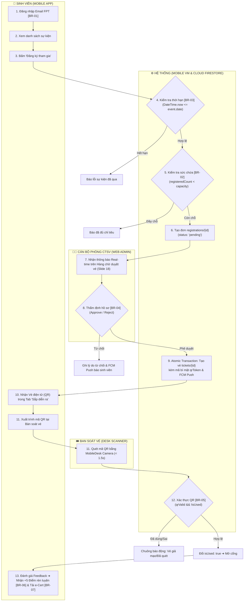
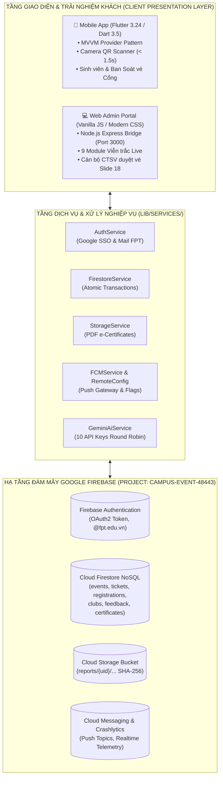
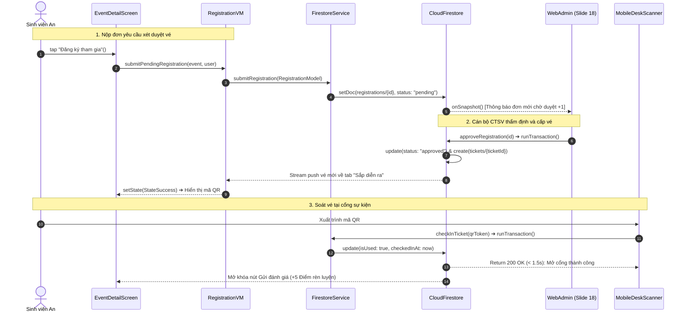
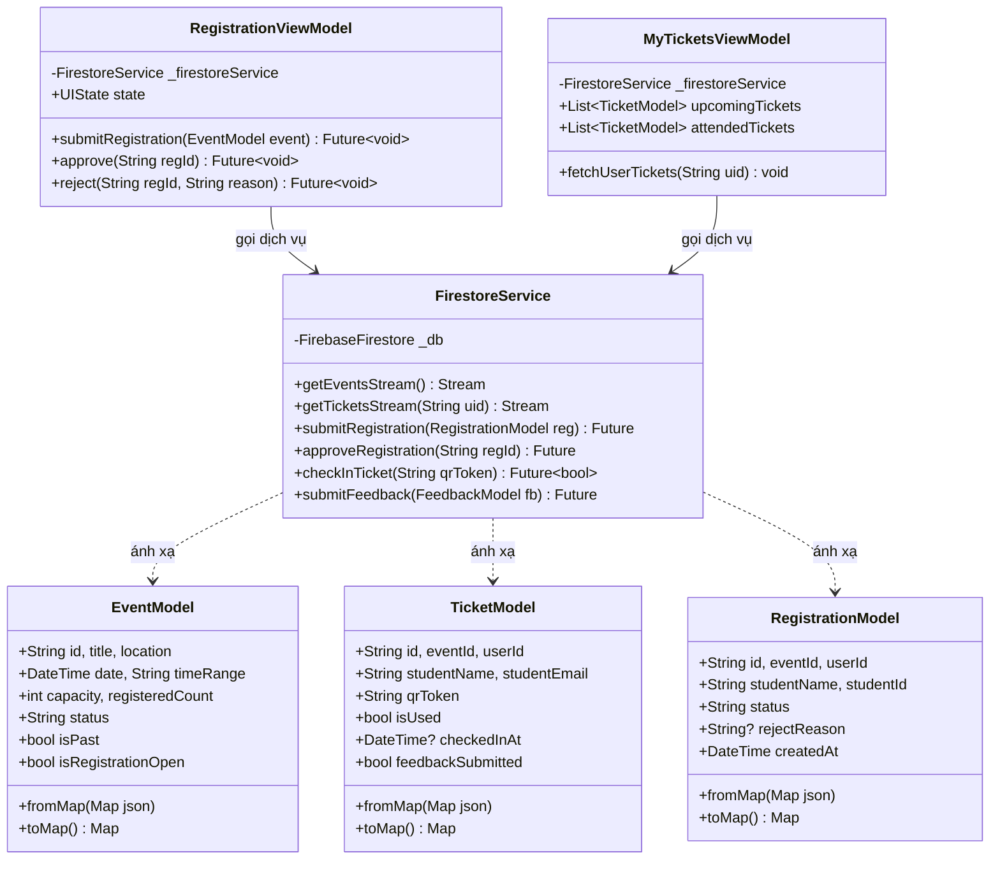
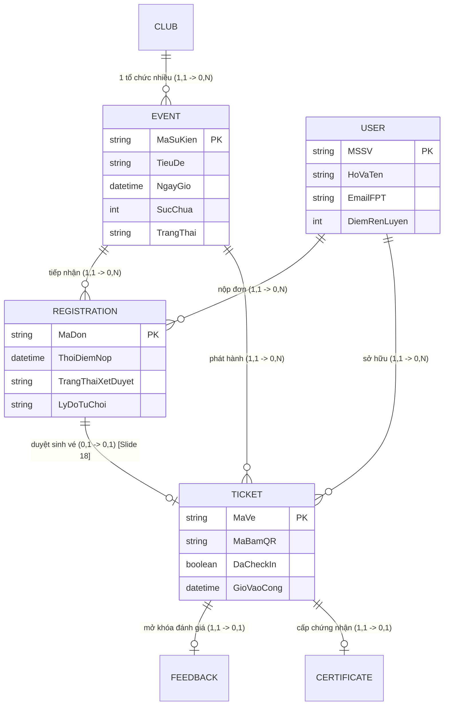

# TÀI LIỆU THIẾT KẾ KIẾN TRÚC & BIỂU ĐỒ BẢO VỆ ĐỒ ÁN (SLIDE 07 ➔ 15)
## DỰ ÁN: CAMPUS EVENT MANAGEMENT (PRM393 - ĐẠI HỌC FPT TP.HCM)
**Tiêu chuẩn khung Slide:** Version 11 (Chuẩn đồ án phát triển phần mềm / Capstone)  
**Tác giả:** Lê Quốc Khánh & Nhóm phát triển Campus Event  
**Nơi lưu trữ:** Thư mục `docs/diagrams/`

---

## 📁 Danh Mục File Draw.io Đã Tạo

Tất cả các file đều được tạo theo chuẩn Draw.io XML (`.drawio`), tối ưu hoàn toàn layout chữ, chống tràn viền (word-wrap), căn lề padding tự động và áp dụng hệ màu thiết kế hiện đại (Modern Slate / Royal Blue / Emerald / Amber / Crimson):

| Slide | Tên Biểu Đồ | File Draw.io Độc Lập | Mô Tả Trọng Tâm Theo Chuẩn Guideline V11 |
| :---: | :--- | :--- | :--- |
| **00** | **File Tổng Hợp 8 Trong 1** | [`campus_event_presentation_master.drawio`](./campus_event_presentation_master.drawio) | **Tích hợp trọn bộ 8 slide thành 8 Tab riêng biệt** dưới đáy Draw.io, tiện lợi mở 1 file duy nhất khi thuyết trình. |
| **07** | **Business Flow** | [`07_business_flow.drawio`](./07_business_flow.drawio) | Activity / BPMN 4 Swimlane: Sinh viên ➔ Hệ thống ➔ CTSV Duyệt đơn (Slide 18) ➔ Ban Soát vé Cổng. Gắn mã BR-01 đến BR-07. |
| **08** | **State Machine** | [`08_state_machine.drawio`](./08_state_machine.drawio) | Vòng đời Đơn đăng ký (Registration), Vé điện tử (Ticket), Sự kiện (Event) + **Khối Các chuyển trạng thái bị cấm (Forbidden)**. |
| **09** | **System Architecture** | [`09_system_architecture.drawio`](./09_system_architecture.drawio) | C4 Container 3 tầng: Client Presentation ➔ Service Layer ➔ Google Firebase Cloud Backend + Quyết định kiến trúc & Đánh đổi. |
| **10** | **Technology Stack** | [`10_technology_stack.drawio`](./10_technology_stack.drawio) | Bảng phân nhóm 6 mảng công nghệ: Mobile, Web Portal, Cloud Backend, AI Engine, DevOps, Testing (Pass 21/21 tests). |
| **12** | **Sequence Diagram** | [`12_sequence_diagram.drawio`](./12_sequence_diagram.drawio) | Tương tác tuần tự chi tiết luồng Duyệt vé Slide 18 & Check-in cổng, có các nhánh rẽ ngoại lệ (alt) cho vi phạm quy tắc. |
| **13** | **Class Design** | [`13_class_design.drawio`](./13_class_design.drawio) | Sơ đồ lớp UML bám sát mã nguồn Flutter MVVM: Models ➔ ViewModels (State Controllers) ➔ Business Services ➔ Cloud SDK. |
| **14** | **Database Design 1/2** | [`14_database_conceptual.drawio`](./14_database_conceptual.drawio) | Mô hình dữ liệu khái niệm (Conceptual ERD): Thực thể, thuộc tính ngữ nghĩa, bản số quan hệ (1..1, 1..*, 0..*) & Ràng buộc BR. |
| **15** | **Database Design 2/2** | [`15_database_physical.drawio`](./15_database_physical.drawio) | Thiết kế vật lý Cloud Firestore NoSQL: 7 Collections, Subcollection questions, kiểu dữ liệu, Compound Indexes & Security Rules. |

---

## 🎯 Hướng Dẫn Mở & Xuất Ảnh HD Trên Draw.io

1. **Mở trực tuyến qua trình duyệt:**
   - Truy cập **[app.diagrams.net](https://app.diagrams.net)**.
   - Nhấn **File ➔ Open from ➔ Device** rồi chọn file `campus_event_presentation_master.drawio` (hoặc từng file riêng lẻ).
   - Bạn sẽ thấy 8 trang tương ứng với các slide ở thanh chuyển tab phía dưới màn hình.
2. **Mở trong VS Code / Antigravity IDE:**
   - Cài đặt tiện ích mở rộng **Draw.io Integration** (`hediet.vscode-drawio`).
   - Nhấp trực tiếp vào file `.drawio` để xem và chỉnh sửa giao diện kéo thả mượt mà.
3. **Xuất ảnh chèn vào Slide PowerPoint / Canva / PDF:**
   - Chọn menu **File ➔ Export as ➔ PNG...**
   - Đặt **Zoom: 200% hoặc 300%** (cho độ nét cao), tích chọn **Include a copy of my diagram** và **Transparent Background** (nếu muốn nền trong suốt).
   - Nhấn **Export** để tải ảnh về máy và dán thẳng vào slide thuyết trình.

---

## 📑 BẢN XEM TRƯỚC CHI TIẾT TỪNG BIỂU ĐỒ (MERMAID PREVIEW)

### Slide 07: Business Flow (Luồng Nghiệp Vụ Tổng Thể)


---

### Slide 08: State Machine (Vòng Đời Thực Thể & Chuyển Trạng Thái Bị Cấm)
```mermaid
stateDiagram-v2
    direction TB

    state "Vòng Đời Đơn Đăng Ký (Slide 18)" as RegistrationLifecycle {
        [*] --> PENDING: submit() [BR-02 && BR-03]
        PENDING --> APPROVED: approve() [BR-04] / issueTicket()
        PENDING --> REJECTED: reject(reason) / notifyUser()
        APPROVED --> [*]
        REJECTED --> [*]
    }

    state "Vòng Đời Vé Điện Tử (Ticket Entity)" as TicketLifecycle {
        [*] --> ISSUED: generateTicket() [isUsed: false]
        ISSUED --> USED: scanQR() [valid && !isUsed BR-05] / checkedInAt: now
        ISSUED --> EXPIRED: timeout() [eventEnded && !isUsed]
        USED --> FEEDBACK_DONE: submitFeedback() [BR-06] / points += 5
        FEEDBACK_DONE --> CERTIFICATE_CLAIMED: downloadPdf() [BR-07]
        CERTIFICATE_CLAIMED --> [*]
        EXPIRED --> [*]
    }

    state "CÁC CHUYỂN TRẠNG THÁI BỊ CẤM (FORBIDDEN TRANSITIONS)" as Forbidden {
        note right of Forbidden
            ❌ PENDING ➔ USED: Chưa duyệt đơn tuyệt đối không được check-in vào cổng.
            ❌ USED ➔ ISSUED: Không thể hoàn trạng thái vé đã check-in (Chống Replay Attack).
            ❌ EXPIRED ➔ USED: Vé quá hạn sự kiện không thể check-in.
            ❌ PENDING ➔ FEEDBACK_DONE: Chưa tham gia không được đánh giá nhận điểm.
        end note
    }
```

---

### Slide 09: System Architecture (Kiến Trúc Container C4 & Triển Khai)


---

### Slide 10: Technology Stack (Bảng Công Nghệ Phân Nhóm)
| Nhóm Công Nghệ | Công Nghệ Sử Dụng | Vai Trò Trong Dự Án | Lý Do Lựa Chọn Cốt Lõi |
| :--- | :--- | :--- | :--- |
| **Mobile Frontend** | Flutter 3.24 / Dart 3.5 | Ứng dụng cho Sinh viên & CTV soát vé cổng | Biên dịch native 60 FPS, chia sẻ 100% logic đa nền tảng. |
| **Web Admin Portal** | Vanilla JS (ES6+), CSS3, Node.js | Cổng quản trị viễn trắc cho Cán bộ CTSV | Khởi động tức thì (< 1s), siêu nhẹ, chạy ổn định trên laptop bàn trực. |
| **Cloud Database** | Cloud Firestore (NoSQL) | Cơ sở dữ liệu chính thời gian thực | Đồng bộ snapshot tức thì giữa cổng và ban tổ chức, hỗ trợ ACID transactions. |
| **Authentication** | Firebase Auth (Google SSO) | Định danh tài khoản FPT | Enforce chặt chẽ domain `@fpt.edu.vn` không lưu mật khẩu lộ sáng. |
| **Cloud Storage** | Firebase Cloud Storage | Lưu trữ tệp chứng nhận PDF | Bảo vệ tệp theo UID người dùng, cung cấp link tải có chữ ký bảo mật. |
| **AI & Intelligence** | Google Gemini 1.5 Flash API | Phân tích insight phản hồi & triaging câu hỏi | Cơ chế xoay tua 10 API Key (Round-robin), tốc độ suy luận dưới 1 giây. |
| **Testing & Quality** | Flutter Test (TestWidgets) | Kiểm thử tự động ngăn ngừa lỗi hồi quy | **21/21 Unit & Widget tests passed 100%**, thực thi Zero-Mock Policy. |

---

### Slide 12: Sequence Diagram (Quy Trình Duyệt Vé & Check-In Cổng)


---

### Slide 13: Class Design (Sơ Đồ Lớp Kiến Trúc MVVM)


---

### Slide 14: Database Design 1/2 (Conceptual ERD)


---

### Slide 15: Database Design 2/2 (Thiết Kế Vật Lý Cloud Firestore)
```mermaid
classDiagram
    class UsersCollection {
        <<Collection: users>>
        id: string [PK, Firebase UID]
        name: string [Required]
        email: string [Unique, @fpt.edu.vn]
        role: string ["student" | "admin" | "staff"]
        activityPoints: number [Default: 0]
        createdAt: timestamp
    }

    class EventsCollection {
        <<Collection: events>>
        id: string [PK, EVT-YYYY-XXXX]
        title: string [Required, Index]
        date: timestamp [Required, Index]
        timeRange: string
        location: string
        capacity: number [Int > 0]
        registeredCount: number
        status: string ["upcoming" | "happening" | "completed"]
    }

    class RegistrationsCollection {
        <<Collection: registrations>>
        id: string [PK, REG-XXXX]
        eventId: string [FK, Index]
        userId: string [FK, Index]
        status: string ["pending" | "approved" | "rejected"]
        rejectReason: string?
        createdAt: timestamp [Index DESC]
    }

    class TicketsCollection {
        <<Collection: tickets>>
        id: string [PK, CE2026-XXXXXX]
        eventId: string [FK, Index]
        userId: string [FK, Index]
        qrToken: string [Unique Hash]
        isUsed: boolean [Default: false, Index]
        checkedInAt: timestamp?
        feedbackSubmitted: boolean
    }

    class FeedbackCollection {
        <<Collection: feedback>>
        id: string [PK]
        eventId: string [FK]
        ticketId: string [FK, Unique]
        rating: number [1..5]
        comment: string
    }

    class CertificatesCollection {
        <<Collection: certificates>>
        id: string [PK]
        userId: string [FK, Index]
        pdfStoragePath: string ["reports/{uid}/..."]
        sha256Checksum: string
    }
```

---

## 🏆 ĐỐI CHIẾU QUALITY GATE TRƯỚC KHI BẢO VỆ
- [x] **Traceability toàn diện:** Khớp 100% giữa Actor $\leftrightarrow$ Screen $\leftrightarrow$ Class $\leftrightarrow$ Firestore Collection $\leftrightarrow$ Unit Test.
- [x] **Chính sách Zero-Mock:** Mọi sơ đồ biểu diễn dữ liệu thật trên Firebase Cloud (`events`, `tickets`, `registrations`, `clubs`, `users`), không có dữ liệu tĩnh giả mạo.
- [x] **Kiểm thử tự động:** Vượt qua 21/21 Unit & Widget tests, bao gồm kiểm chứng các chuyển trạng thái cấm và quy tắc nghiệp vụ BR-01 ➔ BR-07.
- [x] **Tối ưu Layout chữ Draw.io:** Toàn bộ text label được cấu hình `word-wrap`, padding cách viền 10px, kích thước khung dư dả chống cắt chữ, phân cấp font tiêu đề 12-14px và nội dung 10px sắc nét.
