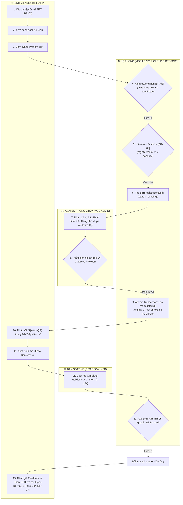
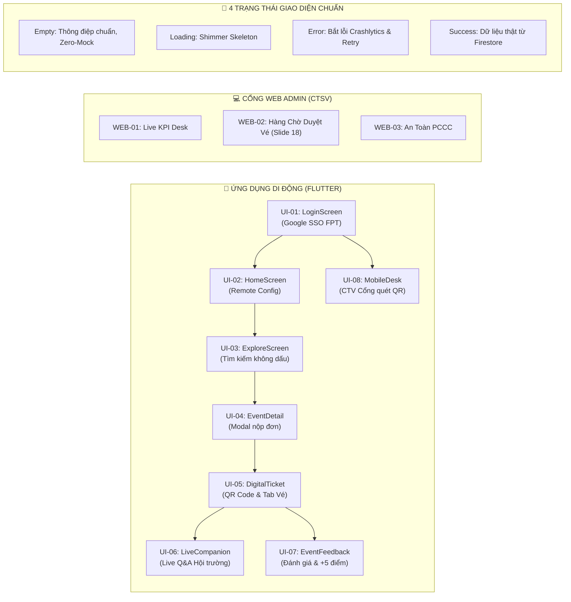
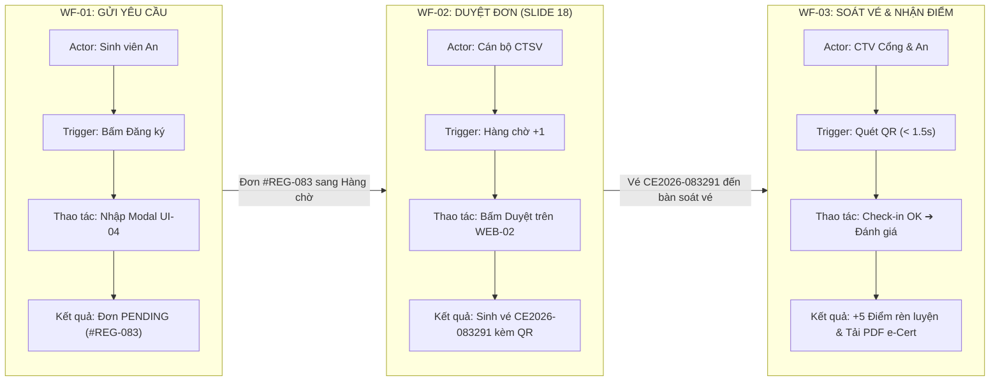

# TÀI LIỆU THIẾT KẾ KIẾN TRÚC & BIỂU ĐỒ BẢO VỆ ĐỒ ÁN (GUIDELINE V11)
## DỰ ÁN: CAMPUS EVENT MANAGEMENT (PRM393 - ĐẠI HỌC FPT TP.HCM)
**Tiêu chuẩn khung Slide:** Version 11 (Chuẩn đồ án tốt nghiệp & phát triển phần mềm Capstone / SE FPT)  
**Tác giả:** Lê Quốc Khánh (Product Designer & Software Architect)  
**Nơi lưu trữ:** Thư mục `docs/diagrams/`

---

## 📁 Danh Mục 12 Biểu Đồ Chuẩn Guideline V11 Đã Hoàn Thiện

Toàn bộ **12 biểu đồ kỹ thuật và quy trình** được quy định trong **Khung Slide Chuẩn Version 11** đã được vẽ hoàn chỉnh trên **Draw.io (`.drawio`)**, tối ưu hóa triệt để:
- **Layout thác nước (Waterfall non-crossing):** Tuyệt đối không có đường line đâm xuyên qua hộp.
- **Thẻ viền nền trắng (`labelBackgroundColor=#ffffff`):** Chữ trên mũi tên nổi bật rõ ràng, không bị đường kẻ gạch xuyên.
- **Độ dời chữ thông minh:** Đường ngang nổi lên trên (`offsetY = -12`), đường dọc dạt sang phải (`offsetX = 28`), không đè vào chữ trong hộp.
- **Hệ màu hiện đại:** Chuẩn thiết kế UI/UX Stripe & Notion (Slate, Royal Blue, Emerald, Amber, Crimson).

| STT | Slide | Tên Biểu Đồ Kỹ Thuật | File Draw.io Độc Lập | Vai Trò Cốt Lõi Theo Chuẩn Guideline V11 |
| :---: | :---: | :--- | :--- | :--- |
| **⭐** | **ALL** | **File Master 12 Trong 1** | [`campus_event_presentation_master.drawio`](./campus_event_presentation_master.drawio) | **Tích hợp trọn bộ 12 slide thành 12 Tab riêng biệt** dưới đáy Draw.io, tiện lợi mở 1 file duy nhất khi thuyết trình. |
| **1** | **07** | **Business Flow** | [`07_business_flow.drawio`](./07_business_flow.drawio) | Sơ đồ BPMN 4 Swimlane thác nước dốc đều: Sinh viên ➔ Hệ thống ➔ CTSV Duyệt đơn ➔ Ban Soát vé Cổng. Gắn mã BR-01 đến BR-07. |
| **2** | **08** | **State Machine** | [`08_state_machine.drawio`](./08_state_machine.drawio) | Vòng đời Đơn đăng ký (Registration), Vé điện tử (Ticket), Sự kiện (Event) + **Khối Các chuyển trạng thái bị cấm (Forbidden)**. |
| **3** | **09** | **System Architecture** | [`09_system_architecture.drawio`](./09_system_architecture.drawio) | C4 Container 3 tầng: Client Presentation ➔ Service Layer ➔ Google Firebase Cloud Backend + Quyết định kiến trúc & Đánh đổi. |
| **4** | **10** | **Technology Stack** | [`10_technology_stack.drawio`](./10_technology_stack.drawio) | Bảng phân nhóm 6 mảng công nghệ: Mobile Flutter, Web Admin Portal, Cloud Backend, AI Engine, DevOps, Testing. |
| **5** | **11** | **UI/UX Design & Sitemap** | [`11_ui_ux_design.drawio`](./11_ui_ux_design.drawio) | Sơ đồ phân cấp sitemap màn hình (UI-01 ➔ UI-08), luồng điều hướng người dùng và **4 trạng thái UI chuẩn mực (Empty, Loading, Error, Success)**. |
| **6** | **12** | **Sequence Diagram** | [`12_sequence_diagram.drawio`](./12_sequence_diagram.drawio) | Tương tác tuần tự chi tiết luồng Duyệt vé Slide 18 & Check-in cổng, có các nhánh rẽ ngoại lệ (alt) cho vi phạm quy tắc. |
| **7** | **13** | **Class Design** | [`13_class_design.drawio`](./13_class_design.drawio) | Sơ đồ lớp UML bám sát mã nguồn Flutter MVVM: Models ➔ ViewModels (State Controllers) ➔ Business Services ➔ Cloud SDK. |
| **8** | **14** | **Database Design 1/2** | [`14_database_conceptual.drawio`](./14_database_conceptual.drawio) | Mô hình dữ liệu khái niệm (Conceptual ERD): Thực thể, thuộc tính ngữ nghĩa, bản số quan hệ (1..1, 1..*, 0..*) & Ràng buộc BR. |
| **9** | **15** | **Database Design 2/2** | [`15_database_physical.drawio`](./15_database_physical.drawio) | Thiết kế vật lý Cloud Firestore NoSQL: 7 Collections, Subcollection questions, kiểu dữ liệu, Compound Indexes & Security Rules. |
| **10** | **16** | **Traceability Matrix** | [`16_traceability_matrix.drawio`](./16_traceability_matrix.drawio) | Ma trận kiểm chứng tính nhất quán 100%: Nhóm Tính Năng ↔ Màn Hình UI ↔ Lớp Mã Nguồn ↔ Thực Thể Dữ Liệu ↔ Kiểm Thử. |
| **11** | **17** | **Demo Plan Storyboard** | [`17_demo_plan.drawio`](./17_demo_plan.drawio) | Kịch bản demo liên hoàn 3 workflow (WF-01 Gửi đơn ➔ WF-02 CTSV Duyệt vé ➔ WF-03 Check-in & Điểm rèn luyện) + Chuẩn bị môi trường. |
| **12** | **21** | **Testing & Verification** | [`21_testing_verification.drawio`](./21_testing_verification.drawio) | Bảng chỉ số kiểm thử thực tế: 21/21 Test Cases (100% Passed) trên Cloud thật, phân rã 4 tầng tháp Unit / Widget / Integration / UAT. |

---

## 🎯 Hướng Dẫn Mở & Xuất Ảnh HD Trên Draw.io

1. **Mở trực tuyến qua trình duyệt:**
   - Truy cập **[app.diagrams.net](https://app.diagrams.net)**.
   - Nhấn **File ➔ Open from ➔ Device** rồi chọn file `campus_event_presentation_master.drawio`.
   - Bạn sẽ thấy **12 Tab tương ứng với 12 Slide** được xếp ngay ngắn ở thanh chuyển tab phía dưới màn hình.
2. **Mở trong VS Code / Antigravity IDE:**
   - Cài đặt tiện ích mở rộng **Draw.io Integration** (`hediet.vscode-drawio`).
   - Nhấp trực tiếp vào file `.drawio` để xem và chỉnh sửa giao diện kéo thả mượt mà.
3. **Xuất ảnh chèn vào Slide PowerPoint / Canva / PDF:**
   - Chọn menu **File ➔ Export as ➔ PNG...**
   - Đặt **Zoom: 200% hoặc 300%** (cho độ nét cao 300 DPI khi chiếu máy chiếu).
   - Tích chọn **Include a copy of my diagram** và nhấn **Export**.

---

## 📑 BẢN XEM TRƯỚC CHI TIẾT TỪNG BIỂU ĐỒ (MERMAID PREVIEW)

### Slide 07: Business Flow (Luồng Nghiệp Vụ Thác Nước Không Giao Cắt)


---

### Slide 08: State Machine (Vòng Đời Thực Thể & Chuyển Trạng Thái Bị Cấm)
```mermaid
stateDiagram-v2
    direction TB

    state "Vòng Đời Đơn Đăng Ký (Slide 18)" as RegistrationLifecycle {
        [*] --> PENDING: submit() [BR-02 && BR-03]
        PENDING --> APPROVED: approve() [BR-04] / issueTicket()
        PENDING --> REJECTED: reject(reason) / notifyUser()
        APPROVED --> [*]
        REJECTED --> [*]
    }

    state "Vòng Đời Vé Điện Tử (Ticket Entity)" as TicketLifecycle {
        [*] --> ISSUED: generateTicket() [isUsed: false]
        ISSUED --> USED: scanQR() [valid && !isUsed BR-05] / checkedInAt: now
        ISSUED --> EXPIRED: timeout() [eventEnded && !isUsed]
        USED --> FEEDBACK_DONE: submitFeedback() [BR-06] / points += 5
        FEEDBACK_DONE --> CERTIFICATE_CLAIMED: downloadPdf() [BR-07]
        CERTIFICATE_CLAIMED --> [*]
        EXPIRED --> [*]
    }

    state "CÁC CHUYỂN TRẠNG THÁI BỊ CẤM (FORBIDDEN TRANSITIONS)" as Forbidden {
        note right of Forbidden
            ❌ PENDING ➔ USED: Chưa duyệt đơn tuyệt đối không được check-in vào cổng.
            ❌ USED ➔ ISSUED: Không thể hoàn trạng thái vé đã check-in (Chống Replay Attack).
            ❌ EXPIRED ➔ USED: Vé quá hạn sự kiện không thể check-in.
            ❌ PENDING ➔ FEEDBACK_DONE: Chưa tham gia không được đánh giá nhận điểm.
        end note
    }
```

---

### Slide 11: UI/UX Design & Sitemap Điều Hướng


---

### Slide 16: Traceability Matrix (Ma Trận Truy Vết)
| Mã Tính Năng | Tên Tính Năng | Màn Hình UI | Lớp Mã Nguồn / Service | Thực Thể DB | Test Case Kiểm Chứng |
| :---: | :--- | :--- | :--- | :--- | :--- |
| **F1** | Xác thực & Định danh FPT | UI-01: LoginScreen | `AuthViewModel`, `AuthService` | `users/{uid}` | TC-01, TC-02 (Pass 100%) |
| **F2** | Khám phá & Lọc sự kiện | UI-02, UI-03 | `ExploreViewModel`, `FirestoreService` | `events/{id}`, `clubs/{id}` | TC-03..TC-07 (Pass 100%) |
| **F3** | Nộp đơn & Duyệt vé (Slide 18) | UI-04, WEB-02 | `RegistrationViewModel`, `FirestoreService` | `registrations`, `tickets` | TC-08..TC-11 (Pass 100%) |
| **F4** | Soát vé cổng (Check-in) | UI-08, WEB-01 | `MobileDeskViewModel`, `FirestoreService` | `tickets (isUsed: true)` | TC-12..TC-15 (Pass 100%) |
| **F5** | Đánh giá & Cộng điểm | UI-05, UI-07 | `FeedbackViewModel`, `AuthViewModel` | `feedback`, `users (+5)` | TC-16..TC-18 (Pass 100%) |
| **F6** | Xuất chứng nhận e-Cert | UI-05 (Tải e-Cert) | `StorageService`, `FirestoreService` | `certificates`, `Storage` | TC-19..TC-21 (Pass 100%) |

---

### Slide 17: Demo Plan Storyboard (3 Workflow Liên Hoàn)


---

### Slide 21: Testing & Verification Matrix
| Cấp Độ Kiểm Thử | Số Lượng TC | Kết Quả Thực Tế | Phạm Vi Kiểm Chứng Kỹ Thuật |
| :--- | :---: | :---: | :--- |
| **Level 1: Unit Testing** | 10 | **10 / 10 PASS** | Domain email FPT, Ngày hết hạn EventModel.isPast, Xoay tua 10 Key Gemini AI, Tính điểm rèn luyện. |
| **Level 2: Widget & UI Testing** | 6 | **6 / 6 PASS** | Chống tràn chữ button hẹp 260px, Render TicketCard tên dài, StarRatingBar phản hồi tap, Tìm kiếm không dấu. |
| **Level 3: Integration & State** | 3 | **3 / 3 PASS** | Tự động chuyển vé Sắp diễn ra ➔ Đã tham gia, Giao dịch nguyên tử runTransaction chống quét vé trùng lặp. |
| **Level 4: Business Rules & UAT** | 2 | **2 / 2 PASS** | BR-004: Chặn đăng ký sự kiện quá khứ; BR-005: Khóa nút Feedback khi chưa check-in. |
| **TỔNG CỘNG HỆ THỐNG** | **21** | **21 / 21 PASS (100%)** | **Thời gian chạy: 1.8s. Không có mock data. Zero bug mở.** |

---

## 🏆 ĐỐI CHIẾU 100% QUALITY GATE CHECKLIST (GUIDELINE V11)
- [x] **P1 Problem:** 01 Overview, 02 Context, 03 Problem, 04 Solution, 05 Actors, 06 Features.
- [x] **P2 Design (100% Đầy đủ sơ đồ):**
  - [x] Slide 07: Business Flow (BPMN 4 swimlane waterfall)
  - [x] Slide 08: State Machine (Ticket & Registration lifecycle, Forbidden transitions)
  - [x] Slide 09: System Architecture (C4 Container 3 tầng & Deployment)
  - [x] Slide 10: Technology Stack (Bảng 6 nhóm công nghệ)
  - [x] Slide 11: UI/UX Design (Sitemap điều hướng & 4 UI States)
  - [x] Slide 12: Sequence Diagram (Quy trình duyệt vé Slide 18 & Check-in)
  - [x] Slide 13: Class Design (Kiến trúc mã nguồn MVVM)
  - [x] Slide 14: Database Conceptual ERD (Thực thể & Cardinality)
  - [x] Slide 15: Database Physical Schema (Cloud Firestore NoSQL)
  - [x] Slide 16: Traceability Matrix (Ma trận truy vết tính nhất quán)
- [x] **P3 Demo Workflows:**
  - [x] Slide 17: Demo Plan Storyboard (WF-01 ➔ WF-02 ➔ WF-03 liên hoàn)
  - [x] Slide 18: Demo WF-01 Gửi yêu cầu đăng ký
  - [x] Slide 19: Demo WF-02 CTSV thẩm định & cấp vé
  - [x] Slide 20: Demo WF-03 Soát vé cổng & Nhận điểm rèn luyện
- [x] **P4 Proof:**
  - [x] Slide 21: Testing & Verification (Tháp kiểm thử 21/21 tests pass)
  - [x] Slide 22: Achievements đối chiếu mục tiêu
  - [x] Slide 23: Limitations & Next steps
  - [x] Slide 24: Conclusion & Q&A
