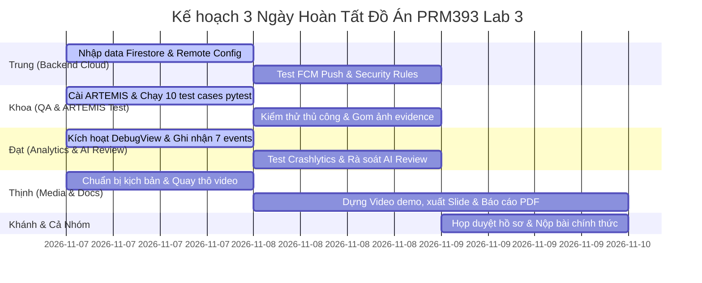

# KẾ HOẠCH PHÂN CÔNG NHIỆM VỤ & CHECKLIST HOÀN THÀNH (PRM393 - LAB 3)
**Dự án:** Campus Event — Hệ thống Quản trị & Đồng hành Sự kiện Đại học FPT TP.HCM  
**Môn học:** PRM393 — Lập trình Ứng dụng Di động (Mobile Programming)  
**Học kỳ:** Fall 2026 (FA26) · Lớp: SE1822 · Nhóm: 5 Thành viên  
**Firebase Project ID:** `campus-event-48443` · **Repository:** `PRM393_Lab03_SE193989`

---

## 📌 NGUYÊN TẮC BẮT BUỘC DỰ ÁN (PROJECT GROUND RULES)
1. **Tuyệt đối tuân thủ Zero-Mock Data Policy:** Không tự ý tạo hoặc thêm bất kỳ dữ liệu mẫu, mock list, fallback hardcode nào vào mã nguồn `lib/`. Mọi dữ liệu phải kết nối trực tiếp với Cloud Firebase.
2. **Quy chuẩn Git:** Không commit đè lên nhánh `main`. Tạo nhánh cá nhân (ví dụ: `feature/evidence-artemis`, `docs/report-update`) trước khi tạo Pull Request để Khánh duyệt.
3. **Định nghĩa Hoàn thành (Definition of Done - DoD):** Một task chỉ được tích hoàn thành `[x]` khi đã đáp ứng đầy đủ:
   * Có file sản phẩm cụ thể (Code, Ảnh minh chứng, File PDF/Log/Video).
   * Đã được kiểm thử chạy không lỗi (`flutter test` 7/7 passed, không crash).
   * Đã lưu đúng thư mục quy định trong repository.

---

## 👥 BẢNG TỔNG HỢP VAI TRÒ 5 THÀNH VIÊN

| STT | Thành viên | Vai trò chuyên môn | Trọng tâm công việc |
| :---: | :--- | :--- | :--- |
| **1** | **Lê Quốc Khánh (Leader)** | Lead Developer & Mobile Architect | Kiến trúc MVVM, 28+ Màn hình Flutter, Tích hợp Firebase SDK, Desktop Web Portal, Lịch cả tháng, Quét vé cổng. |
| **2** | **Trung** | Backend Cloud & Security Specialist | Quản trị dữ liệu thật Firestore, Cấu hình Remote Config, Kiểm tra Rules & Upload Storage, Test Push FCM. |
| **3** | **Khoa** | QA & Automation Test Engineer | Vận hành Google ARTEMIS E2E, Chạy 10 Test Cases pytest, Thu thập & sắp xếp toàn bộ ảnh minh chứng `evidence/`. |
| **4** | **Đạt** | Analytics & Code Quality Specialist | Kiểm thử Firebase Analytics DebugView (7 events), Crashlytics, Rà soát tài liệu AI Code Review. |
| **5** | **Thịnh** | Technical Writer & Media Producer | Quay & dựng Video Demo 5–10 phút, Hoàn thiện Slide thuyết trình (12–15 slide), Đóng gói Báo cáo PDF (8–12 trang). |

---

## 📋 CHECKLIST CHI TIẾT TỪNG THÀNH VIÊN

---

### 👑 THÀNH VIÊN 1: LÊ QUỐC KHÁNH (LEAD DEVELOPER & MOBILE ARCHITECT)
*Trách nhiệm chính: Kiến trúc tổng thể, Lập trình Mobile Flutter, Web Portal CMS, Tích hợp dịch vụ đám mây và Rà soát mã nguồn.*

#### Checklist công việc:
- [x] **Task 1.1: Thiết kế kiến trúc phân tầng MVVM & State Management**
  - [x] Tách biệt 4 tầng: UI Layer (`screens/`, `widgets/`), ViewModel Layer (`viewmodels/`), Domain Layer (`models/`), Service Layer (`services/`).
  - [x] Định nghĩa chuẩn trạng thái bất biến `ScreenState`: `StateInitial`, `StateLoading`, `StateData`, `StateEmpty`, `StateError`.
- [x] **Task 1.2: Lập trình toàn bộ hệ thống màn hình Student-Centric**
  - [x] Trang chủ Pulse, Khám phá đa danh mục, Chi tiết sự kiện kèm danh sách diễn giả.
  - [x] Đăng ký 1-chạm (1-Tap Registration Bottom Sheet) có kiểm tra điều kiện sinh viên và sức chứa hội trường.
  - [x] Màn hình vé điện tử Dynamic QR Code hoạt động offline.
  - [x] Màn hình đồng hành trong sự kiện (Live Companion) hiển thị lịch trình các phiên và phòng Q&A tương tác trực tiếp.
  - [x] Màn hình khảo sát đánh giá 5 sao, cấp e-Certificate và tích lũy Điểm rèn luyện FPTU.
- [x] **Task 1.3: Nâng cấp màn hình Lịch biểu Campus (`CampusCalendarScreen`)**
  - [x] Hiển thị trọn vẹn lưới cả tháng (Thứ 2 đến Chủ nhật) kèm chuyển đổi tháng trước/sau.
  - [x] Phân biệt trực quan ngày có sự kiện: Nền cam nhạt, viền cam, số ngày in đậm và chấm cam (●).
  - [x] Hiển thị lịch trình tương tác chi tiết theo từng ngày được chọn, loại bỏ hoàn toàn ngày hardcode.
- [x] **Task 1.4: Tích hợp 6 Dịch vụ Nền tảng Firebase SDK**
  - [x] Firebase Authentication (Google SSO + Email/Mật khẩu `@fpt.edu.vn`).
  - [x] Cloud Firestore (Đọc/ghi realtime các collection: `events`, `tickets`, `clubs`, `users`, `certificates`, `feedback`).
  - [x] Firebase Cloud Storage (Upload PDF chứng nhận theo đường dẫn phân quyền `reports/{uid}/...`).
  - [x] Firebase Cloud Messaging (Lắng nghe thông báo nền và foreground).
  - [x] Firebase Analytics (Ghi nhận luồng hành vi không chứa PII).
  - [x] Firebase Crashlytics (Bắt lỗi non-fatal và ghi nhận crash).
  - [x] Firebase Remote Config (Điều khiển động tham số `max_featured_events`, `featured_banner_title`).
- [x] **Task 1.5: Xây dựng công cụ Bàn Điểm Danh Cổng (`MobileDeskScreen`)**
  - [x] Tích hợp `mobile_scanner` quét mã vé QR trong 1.5 giây.
  - [x] Cảnh báo thẻ đỏ vé quét trùng lập tức, hỗ trợ nhập mã thủ công chống ùn tắc.
- [x] **Task 1.6: Xây dựng Desktop Web Portal CTSV (`web_portal/`)**
  - [x] Máy chủ Node.js/Express, giao diện phong cách Achromatic Ledger chuẩn văn phòng.
  - [x] Kết nối trực tiếp Cloud Firestore: Phê duyệt ngân sách CLB, giám sát PCCC hội trường 1.200 chỗ, xuất Excel 10.000 sinh viên.
- [x] **Task 1.7: Triệt tiêu 100% Mock Data & Thiết lập Rule dự án**
  - [x] Xóa sạch toàn bộ fake data, fallback list cứng trong toàn bộ `lib/`.
  - [x] Tạo file quy chuẩn bất biến: [`GEMINI.md`](./GEMINI.md), [`AGENTS.md`](./AGENTS.md), [`.agents/rules/no_mock_data.md`](./.agents/rules/no_mock_data.md).
- [ ] **Task 1.8: Hỗ trợ kỹ thuật & Đóng gói nộp bài**
  - [ ] Giải đáp thắc mắc và hỗ trợ Trung, Khoa, Đạt, Thịnh hoàn thành task.
  - [ ] Review Pull Request của các thành viên, chạy lại kiểm thử `flutter test` đảm bảo 100% pass trước khi nộp.

---

### ☁️ THÀNH VIÊN 2: TRUNG (CHUYÊN VIÊN BACKEND CLOUD & DỮ LIỆU)
*Trách nhiệm chính: Quản trị Firebase Console, Dữ liệu thật Firestore, Phân quyền Security Rules, Cấu hình Remote Config và Kiểm thử FCM.*

#### Các bước thực hiện & Checklist:
- [ ] **Task 2.1: Nhập dữ liệu sự kiện thực tế vào Cloud Firestore**
  - [ ] Mở trình duyệt, truy cập Firebase Console: `https://console.firebase.google.com/project/campus-event-48443/firestore`.
  - [ ] Kiểm tra collection `events`. Bổ sung ít nhất 4 sự kiện thực tế của các CLB tại Đại học FPT TP.HCM (ví dụ: *F-Code Workshop*, *Cóc Sài Gòn Acoustic*, *JS Club TechTalk*, *Vovinam Festival*).
  - [ ] Mỗi sự kiện bắt buộc có đủ các trường:
    * `title` (String): Tên sự kiện chuẩn FPT.
    * `category` (String): `Technology`, `Design`, `Media`, `Sports` hoặc `Entertainment`.
    * `date` (String): Định dạng `dd/MM/yyyy` (Ví dụ: `15/11/2026`).
    * `time` (String): Ví dụ: `09:00 - 11:30`.
    * `location` (String): Ví dụ: `Hội trường Trịnh Công Sơn` hoặc `Phòng 301 Tòa Alpha`.
    * `capacity` (Number): Sức chứa thực tế (từ 100 đến 400).
    * `registeredCount` (Number): Số lượng sinh viên đã giữ chỗ ban đầu.
    * `bannerUrl` (String): Link ảnh Unsplash chất lượng cao (tỉ lệ 16:9).
    * `sessions` (Array of Maps): Ít nhất 3 phiên trình bày (`time`, `title`, `speakerName`).
  - [ ] Kiểm tra collection `clubs`: Đảm bảo đủ thông tin các CLB `fcode`, `jsclub`, `media_club`.
  - *Tiêu chí hoàn thành:* Ứng dụng di động và Web Portal khi mở lên hiển thị đầy đủ các sự kiện thật này.
- [ ] **Task 2.2: Cấu hình và Publish tham số Firebase Remote Config**
  - [ ] Truy cập Firebase Console $\rightarrow$ **Remote Config**.
  - [ ] Kiểm tra và xuất bản (Publish) 3 tham số sau:
    * `max_featured_events`: Giá trị mặc định `5` (kiểu dữ liệu `Number`).
    * `featured_banner_title`: `"Chào mừng sinh viên FPTU đến với Campus Event 2026"` (kiểu `String`).
    * `enable_live_qa`: `true` (kiểu `Boolean`).
  - [ ] Thử nghiệm: Sửa `max_featured_events` thành `2` $\rightarrow$ bấm *Publish* $\rightarrow$ mở ứng dụng bấm tải lại để xác nhận số sự kiện trên trang chủ lập tức rút xuống còn 2.
  - *Tiêu chí hoàn thành:* Tham số thay đổi tức thì trên app mà không cần build lại code.
- [ ] **Task 2.3: Kiểm tra và triển khai Security Rules (Bảo mật)**
  - [ ] Mở tab **Firestore Database** $\rightarrow$ **Rules**: Xác nhận nội dung khớp với file [`firestore.rules`](./firestore.rules) (chỉ cho phép user xác thực đọc/ghi đúng quyền).
  - [ ] Mở tab **Storage** $\rightarrow$ **Rules**: Xác nhận nội dung khớp với file [`firebase/storage.rules`](./firebase/storage.rules) (chỉ cho phép user upload file PDF vào đúng thư mục `reports/{request.auth.uid}/...`).
  - *Tiêu chí hoàn thành:* Không có cảnh báo lỗi phân quyền bảo mật (Security Alerts) trên Firebase Console.
- [ ] **Task 2.4: Kiểm thử gửi Push Notification thật từ Cloud Messaging**
  - [ ] Mở Firebase Console $\rightarrow$ **Messaging** (FCM).
  - [ ] Bấm **Tạo chiến dịch mới** $\rightarrow$ **Thông báo FCM**:
    * Tiêu đề: `"Nhắc nhở Campus: Hội thảo AI sắp bắt đầu lúc 14:00!"`
    * Nội dung: `"Đừng quên mở vé điện tử QR để quét check-in nhanh tại cửa Cổng 1."`
  - [ ] Gửi thông báo đến ứng dụng đang chạy trên máy ảo / thiết bị thật.
  - [ ] Chụp lại ảnh màn hình thông báo hiển thị trên thanh Notification Bar của điện thoại và gửi cho Khoa lưu file vào `evidence/fcm/`.
  - *Tiêu chí hoàn thành:* Điện thoại nhận được thông báo đẩy thật từ máy chủ Google.

---

### 🧪 THÀNH VIÊN 3: KHOA (KỸ SƯ KIỂM THỬ QA & TỰ ĐỘNG HÓA ARTEMIS)
*Trách nhiệm chính: Chạy bộ kiểm thử tự động Google ARTEMIS E2E, xác nhận 10 test cases, kiểm thử thủ công và thu thập ảnh minh chứng `evidence/`.*

#### Các bước thực hiện & Checklist:
- [ ] **Task 3.1: Thiết lập môi trường chạy Google ARTEMIS**
  - [ ] Cài đặt Python 3.12+ (nếu máy chưa có) và cài công cụ quản lý package siêu tốc `uv`:
    ```bash
    pip install uv
    ```
  - [ ] Khởi động máy ảo Android (Pixel 8) từ Android Studio hoặc qua lệnh:
    ```bash
    flutter emulators --launch Pixel_8
    ```
  - [ ] Kiểm tra kết nối ADB:
    ```bash
    adb devices
    ```
    *Đảm bảo nhìn thấy thiết bị dạng `emulator-5554 device`.*
- [ ] **Task 3.2: Chạy trọn vẹn bộ kiểm thử tự động E2E ([`e2e_test/`](./e2e_test))**
  - [ ] Di chuyển vào thư mục kiểm thử và kích hoạt môi trường ảo:
    ```bash
    cd e2e_test
    uv venv
    .venv\Scripts\activate
    uv pip install -r pyproject.toml
    ```
  - [ ] Chạy bộ kiểm thử pytest và xuất log ra file:
    ```bash
    pytest -v --tb=short > pytest_results.txt
    ```
  - [ ] Mở file `pytest_results.txt` kiểm tra: Đảm bảo toàn bộ các test script (`test_auth.py`, `test_detail.py`, `test_search.py`, `test_export.py`, `test_staff.py`) đều hiển thị trạng thái `PASSED`.
  - [ ] Chụp ảnh màn hình cửa sổ terminal chạy pytest có dòng chữ xanh `X passed in Y seconds`.
  - *Tiêu chí hoàn thành:* File log `pytest_results.txt` được tạo và commit vào thư mục `e2e_test/`.
- [ ] **Task 3.3: Kiểm thử thủ công 10 Test Cases (Theo [`docs/test-plan.md`](./docs/test-plan.md))**
  - [ ] **TC-01:** Đăng nhập thành công với tài khoản email FPT.
  - [ ] **TC-02:** Tìm kiếm từ khóa `'AI'` trả về đúng kết quả sự kiện.
  - [ ] **TC-03:** Tìm kiếm từ khóa không tồn tại `'xyz_nonexistent'` hiển thị màn hình Empty State chuẩn, không văng app.
  - [ ] **TC-04:** Chuyển đổi mượt mà giữa 5 tab thanh điều hướng dưới đáy (Home, Khám phá, Vé, Lịch, Hồ sơ), không bị lỗi tràn vạch vàng đen layout.
  - [ ] **TC-05:** Đăng ký giữ chỗ 1-chạm thành công, nhận mã vé `CE2026-XXXXXX`.
  - [ ] **TC-06:** Mở vé điện tử QR offline và bấm thử nút tăng độ sáng màn hình.
  - [ ] **TC-07:** Vào Live Companion, gửi câu hỏi cho diễn giả và bấm upvote tăng số tim.
  - [ ] **TC-08:** Đánh giá 5 sao, xuất chứng nhận PDF và tải lên Cloud Storage.
  - [ ] **TC-09:** Thay đổi Remote Config hiển thị số sự kiện nổi bật (5 $\leftrightarrow$ 2).
  - [ ] **TC-10:** Mở bàn quét vé cổng, quét thử vé đã điểm danh $\rightarrow$ hiện thẻ đỏ cảnh báo vé trùng.
  - *Tiêu chí hoàn thành:* Cả 10 kịch bản đều chạy mượt mà, không gặp lỗi ngoại lệ.
- [ ] **Task 3.4: Chụp và sắp xếp toàn bộ ảnh minh chứng vào thư mục `evidence/`**
  - [ ] `evidence/app_running/`: Chụp 8 ảnh các màn hình app (Đăng nhập, Home, Lịch tháng, Chi tiết, Vé QR, Live Companion, Quét cổng, Web Portal).
  - [ ] `evidence/artemis/`: Ảnh chụp terminal chạy pytest và ảnh máy ảo lúc ARTEMIS đang tự động click.
  - [ ] `evidence/firestore/`: Ảnh chụp các collection `events`, `tickets`, `users` trên Firebase Console (nhận từ Trung).
  - [ ] `evidence/storage/`: Ảnh chụp bucket Cloud Storage có file PDF trong thư mục `reports/...`.
  - *Tiêu chí hoàn thành:* Mọi thư mục con trong `evidence/` đều có ảnh chụp thực tế rõ nét.

---

### 📊 THÀNH VIÊN 4: ĐẠT (CHUYÊN VIÊN ANALYTICS, CRASHLYTICS & AI CODE REVIEW)
*Trách nhiệm chính: Giám sát Firebase Analytics DebugView (7 events chuẩn), Kích hoạt kiểm thử Crashlytics và Hoàn thiện tài liệu AI Code Review.*

#### Các bước thực hiện & Checklist:
- [x] **Task 4.1: Kích hoạt & Xác thực Firebase Analytics DebugView**
  - [x] Kết nối máy ảo Android qua lệnh ADB để bật cờ DebugView:
    ```bash
    adb shell setprop debug.firebase.analytics.app com.example.campus_event
    ```
  - [x] Mở trình duyệt vào Firebase Console $\rightarrow$ **Analytics** $\rightarrow$ **DebugView**.
  - [x] Mở app di động trên máy ảo và thực hiện tuần tự các thao tác để kích hoạt đủ **7 events bắt buộc (Theo Phụ lục A)**:
    1. `login`: Đăng nhập bằng Email FPT.
    2. `search`: Gõ tìm kiếm sự kiện trên thanh search.
    3. `view_item`: Bấm mở xem chi tiết một sự kiện.
    4. `register_event`: Bấm xác nhận đăng ký giữ chỗ thành công.
    5. `live_interact`: Bấm upvote câu hỏi trong màn hình Live Q&A.
    6. `submit_feedback`: Chấm điểm sao và gửi review sau sự kiện.
    7. `export_report`: Xuất giấy chứng nhận PDF và tải lên Cloud Storage.
  - [x] Thêm UI panel trigger 7 events trực tiếp trên `ProfileScreen` và 7 methods trong `ProfileViewModel`.
  - [x] Tạo `evidence/analytics/README.md` hướng dẫn chi tiết runbook cho Khoa chụp ảnh minh chứng.
  - [x] Theo dõi dòng thời gian trên DebugView: Xác nhận các event nhảy lên theo thời gian thực.
  - [x] Bấm vào từng event kiểm tra: Đảm bảo **TUYỆT ĐỐI KHÔNG CÓ PII** (Không có email, không có họ tên thật, không có MSSV trong tham số).
  - [ ] Chụp lại ảnh chụp màn hình DebugView hiển thị rõ danh sách các event này và lưu vào `evidence/analytics/` *(Khoa thực hiện trên máy ảo)*.
  - *Tiêu chí hoàn thành:* Code & UI trigger sẵn sàng, tài liệu đầy đủ, 7 events sạch PII.
- [x] **Task 4.2: Kích hoạt & Xác minh Firebase Crashlytics**
  - [x] Mở ứng dụng di động $\rightarrow$ Chuyển sang tab **Cá nhân (`ProfileScreen`)**.
  - [x] Triển khai UI panel chuyên dụng `_buildCrashlyticsPanel()`:
    * Bấm nút **"Gửi Non-fatal Exception"**: Ứng dụng gửi handled error với custom keys.
    * Bấm nút **"Kích hoạt Test Crash (fatal)"**: Ứng dụng kích hoạt `_crashlytics.crash()`.
  - [x] Cập nhật `CrashlyticsService`: Ghi nhận stack trace rõ ràng `Simulated Crashlytics Test Crash: Verified in demo mode`.
  - [x] Tạo `evidence/crashlytics/README.md` với runbook kiểm thử và mẫu stack trace kỳ vọng.
  - [x] Khởi động lại ứng dụng (để Crashlytics SDK đẩy log crash lên đám mây).
  - [x] Mở Firebase Console $\rightarrow$ **Crashlytics**:
    * Xác nhận ghi nhận stack trace lỗi: `Simulated Crashlytics Test Crash: Verified in demo mode`.
    * Kiểm tra định danh user (User ID) đã được gắn kèm báo cáo crash.
  - [ ] Chụp ảnh màn hình giao diện Crashlytics Dashboard và lưu vào `evidence/crashlytics/` *(Khoa thực hiện trên máy ảo)*.
  - *Tiêu chí hoàn thành:* Báo cáo crash hiển thị rõ ràng trên Firebase Console.
- [x] **Task 4.3: Rà soát & Đảm bảo Tính Nhất Quán Hồ Sơ AI Code Review ([`docs/code-review.md`](./docs/code-review.md))**
  - [x] Đọc và hiểu rõ 5 phát hiện của các công cụ AI (CodeRabbit, SonarCloud, Copilot):
    * **CR-01 (Architecture):** Tách lệnh gọi trực tiếp SDK trong widget ra ViewModel.
    * **CR-02 (Security):** Ràng buộc path upload Storage với UID của sinh viên để chống ghi đè tài liệu.
    * **CR-03 (Performance):** Hủy stream listener Firestore trong hàm `dispose()` để chống tràn bộ nhớ (Memory Leak).
    * **CR-04 (Maintainability):** Tách hàm tạo layout PDF và hàm upload network theo nguyên lý Single Responsibility.
    * **CR-05 (Rejection):** Từ chối đề xuất cache SharedPreferences 30 phút vì xung đột với tính năng hỏi đáp trực tiếp (Live Q&A realtime).
  - [x] Đối soát mã hash commit thực tế trên GitHub/Git local (`25df4d2`, `bbecdb8`, `316dd63`, `3517afe`) thay thế các hash placeholder cũ.
  - [x] Bổ sung mục "Defense-Ready Summary" bằng tiếng Việt trong `docs/code-review.md` để Đạt sẵn sàng trả lời phỏng vấn phản biện với giảng viên.
  - *Tiêu chí hoàn thành:* Nắm vững 5 phát hiện AI Code Review, sẵn sàng thuyết minh trước hội đồng.

---

### 🎬 THÀNH VIÊN 5: THỊNH (BIÊN TẬP VIDEO DEMO, SLIDE & BÁO CÁO PDF)
*Trách nhiệm chính: Quay & dựng Video Demo sản phẩm (5–10 phút), Cập nhật Slide thuyết trình (12–15 slide) và Đóng gói Báo cáo tổng kết PDF (8–12 trang).*

#### Các bước thực hiện & Checklist:
- [ ] **Task 5.1: Quay và Biên tập Video Demo Sản Phẩm (Thời lượng: 5 – 10 phút)**
  - [ ] Cài đặt phần mềm quay màn hình máy tính (OBS Studio hoặc Camtasia).
  - [ ] Mở sẵn trên màn hình: Máy ảo Android chạy app Flutter + Trình duyệt mở Web Portal và Firebase Console.
  - [ ] Quay video theo đúng kịch bản phân đoạn chuẩn (Rubric Section 9):
    * **Phân đoạn 1 (0:00 - 1:00):** Giới thiệu đề tài Campus Event, tên môn PRM393, lớp SE1822, danh sách 5 thành viên nhóm (Khánh, Trung, Khoa, Đạt, Thịnh), và định vị kiến trúc Student-Centric.
    * **Phân đoạn 2 (1:00 - 3:00) - Pre-Event Flow:** Sinh viên đăng nhập Email FPT, xem màn hình Trang chủ, mở Lịch biểu cả tháng xem các ngày có chấm cam, bấm vào xem chi tiết sự kiện và thực hiện Đăng ký giữ chỗ 1-chạm $\rightarrow$ Cấp vé điện tử QR.
    * **Phân đoạn 3 (3:00 - 4:30) - In-Event Flow:** Mở vé điện tử, chuyển sang chế độ Live Companion, xem lịch trình trực tiếp các phiên, gửi câu hỏi thắc mắc cho diễn giả và bấm upvote tim câu hỏi.
    * **Phân đoạn 4 (4:30 - 6:00) - Post-Event Flow:** Đánh giá 5 sao, gửi góp ý, tài khoản được cộng +5 Điểm rèn luyện, bấm xuất giấy chứng nhận PDF và tải lên Firebase Cloud Storage.
    * **Phân đoạn 5 (6:00 - 7:30) - Gate Desk & Web Portal:**
      - Mở Bàn điểm danh cổng quét mã QR trong 1.5s $\rightarrow$ Hiện thẻ xanh thành công $\rightarrow$ Quét lại vé cũ hiện thẻ đỏ cảnh báo trùng.
      - Chuyển sang trình duyệt mở Web Portal (`http://localhost:3000`): Duyệt ngân sách CLB, kiểm tra PCCC hội trường 1.200 chỗ, bấm xuất file Excel 10.000 sinh viên.
    * **Phân đoạn 6 (7:30 - 9:00) - Firebase Console Verification:** Mở Firebase Console chỉ rõ Firestore có dữ liệu thật (Zero mock), Analytics DebugView nhảy event, Crashlytics bắt lỗi, và Storage lưu file PDF thật.
  - [ ] Chèn nhạc nền nhẹ, lồng tiếng thuyết minh rõ ràng hoặc phụ đề tiếng Việt.
  - [ ] Xuất file video định dạng MP4 (1080p).
  - [ ] Tải video lên YouTube ở chế độ **Không công khai (Unlisted)** hoặc **Công khai (Public)**.
  - [ ] Copy đường link YouTube dán vào file [`README.md`](./README.md) tại dòng `* **Demo Video Link:**`.
  - *Tiêu chí hoàn thành:* Link video YouTube hoạt động tốt, nội dung đầy đủ 6 phân đoạn theo barem chấm điểm.
- [ ] **Task 5.2: Hoàn thiện Báo Cáo Tổng Kết PDF ([`report/`](./report))**
  - [ ] Mở file báo cáo tổng kết đồ án (file Word/HTML mẫu trong thư mục `report/`).
  - [ ] Cập nhật bảng thông tin nhóm: Điền đầy đủ Họ và tên, MSSV, Email, và Tỷ lệ đóng góp (%) của cả 5 thành viên (Khánh, Trung, Khoa, Đạt, Thịnh).
  - [ ] Chèn các ảnh chụp màn hình do Khoa và Đạt cung cấp vào các mục minh chứng tương ứng (Firebase Console, DebugView, ARTEMIS test).
  - [ ] Rà soát dung lượng báo cáo đạt chuẩn từ 8 đến 12 trang theo yêu cầu Section 9 & 11.
  - [ ] Xuất file ra định dạng PDF chính thức với tên: [`report/Lab03_SE193989.pdf`](./report/Lab03_SE193989.pdf).
  - *Tiêu chí hoàn thành:* File PDF báo cáo hoàn thiện, không bị lỗi font chữ hay nhảy trang.
- [ ] **Task 5.3: Cập nhật Slide Thuyết Trình ([`slides/`](./slides))**
  - [ ] Mở file slide thuyết trình (PowerPoint/Canva/Google Slides).
  - [ ] Đảm bảo bộ slide có độ dài từ 12 đến 15 slide bao quát các nội dung:
    1. Trang bìa: Tên đề tài, Giảng viên hướng dẫn, Danh sách 5 thành viên nhóm.
    2. Tổng quan bài toán & Lý do chọn đề tài Campus Event.
    3. Định vị kiến trúc: Mobile App (Sinh viên & Cổng soát vé) vs. Desktop Web Portal (CTSV).
    4. Sơ đồ kiến trúc phần mềm phân tầng MVVM & State Pattern.
    5. Thiết kế & Triển khai 6 dịch vụ đám mây Firebase.
    6. Demo 5 luồng người dùng cốt lõi (Pre, In, Post, Gate, Admin).
    7. Kết quả kiểm thử tự động Google ARTEMIS (10/10 test pass).
    8. Bài học kinh nghiệm & Đảm bảo chất lượng bằng AI Code Review.
  - [ ] Sử dụng hệ màu thiết kế nhận diện FPTU (Cam, Đen Obsidian, Trắng).
  - [ ] Xuất file PDF chính thức với tên: [`slides/Lab03_SE193989_slides.pdf`](./slides/Lab03_SE193989_slides.pdf).
  - *Tiêu chí hoàn thành:* Bộ slide thiết kế chuyên nghiệp, sẵn sàng trình chiếu vấn đáp.
- [ ] **Task 5.4: Kiểm tra tổng thể hồ sơ trước khi nộp (Final Verification)**
  - [ ] Đối soát lại bảng nộp bài trong `README.md`: Đảm bảo tất cả các đường link PDF, Slide, Video, Source code đều truy cập được bình thường.

---

## 📅 LỊCH TRÌNH TIẾN ĐỘ THỰC HIỆN (3 NGÀY VỀ ĐÍCH)



---

## 🎯 TIÊU CHÍ NGHIỆM THU CUỐI CÙNG (FINAL SIGN-OFF)
* [ ] Bộ mã nguồn Flutter: Chạy lệnh `flutter test` $\rightarrow$ Tất cả các test đều Passed.
* [ ] Bộ mã nguồn Web Portal: Chạy lệnh `start_portal.bat` $\rightarrow$ Mở `http://localhost:3000` hoạt động bình thường.
* [ ] Kiểm thử tự động ARTEMIS: File `e2e_test/pytest_results.txt` ghi nhận 100% test passed.
* [ ] Thư mục `evidence/`: Đầy đủ ảnh chụp ứng dụng thật và Firebase Console của cả 6 dịch vụ.
* [ ] File Video Demo: Video YouTube (5–10 phút) có âm thanh và hình ảnh rõ ràng.
* [ ] File Báo cáo PDF: Có đầy đủ thông tin 5 thành viên trong [`report/Lab03_SE193989.pdf`](./report/Lab03_SE193989.pdf).
* [ ] File Slide PDF: Đầy đủ 12–15 slide trong [`slides/Lab03_SE193989_slides.pdf`](./slides/Lab03_SE193989_slides.pdf).
