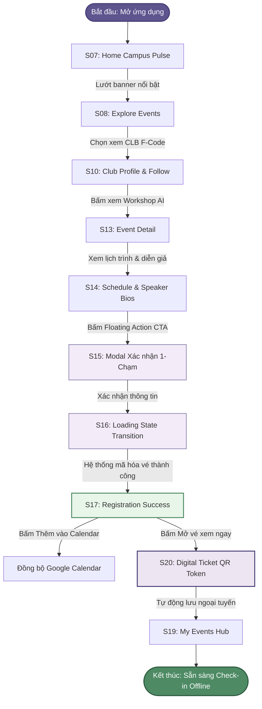
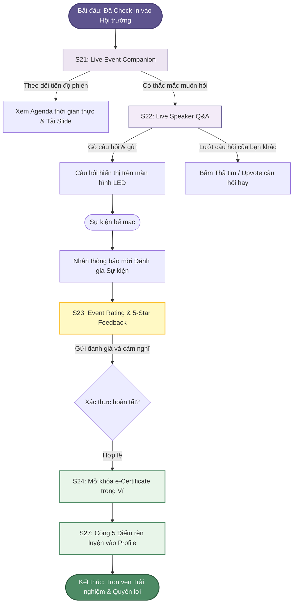
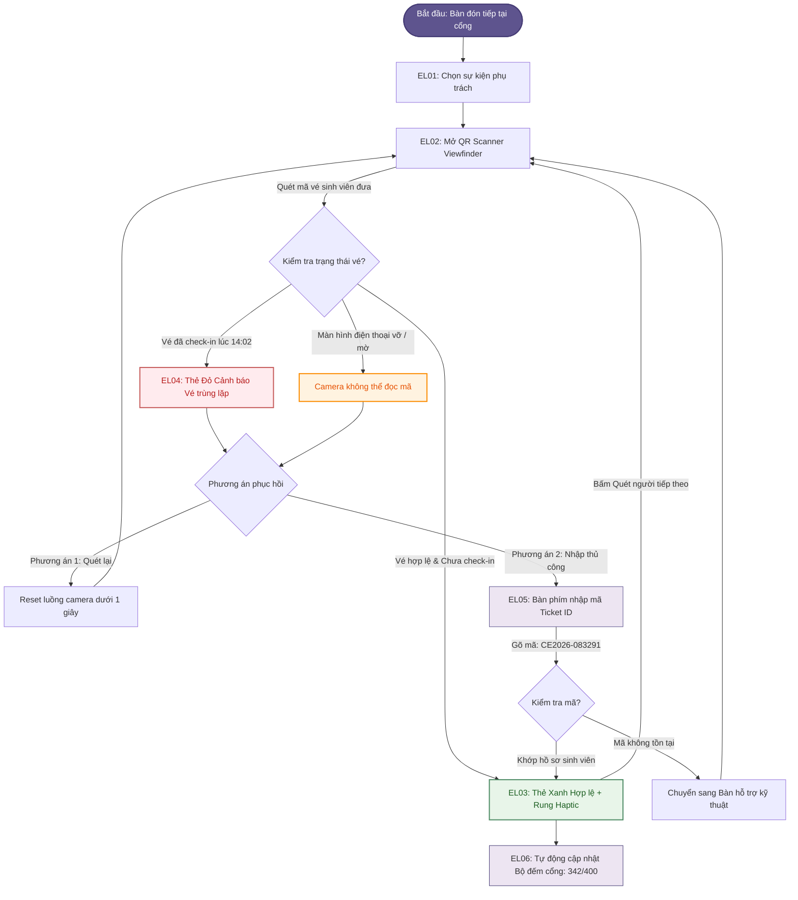

# CAMPUS EVENT — INFORMATION ARCHITECTURE & USER FLOWS
**Môn học:** PRM323 / PRM393 — Mobile Programming & UI/UX Design  
**Đề tài:** Hệ thống Quản lý, Tham gia Sự kiện & Điểm danh QR — ĐH FPT TP.HCM  
**Tài liệu:** Kiến trúc Thông tin & 3 Luồng Người dùng Cốt lõi (`ux/user-flow.md`) — Tái cấu trúc "Student-Centric Mobile First"

---

## 1. Information Architecture (Kiến trúc Thông tin & Sitemap v3.0)

Hệ thống **Campus Event** được tái cấu trúc triệt để nhằm đặt **Sinh viên (End-User)** làm trọng tâm cốt lõi (chiếm 80%+ cấu trúc hệ thống), đồng thời tinh gọn công cụ của Ban tổ chức thành chế độ tác vụ cơ động tại cổng (Mobile Desk) và đưa các nghiệp vụ quản trị nặng về nền tảng Web CMS phù hợp.

```
┌────────────────────────────────────────────────────────────────────────────────────────┐
│                         CAMPUS EVENT APP (STUDENT-FIRST SITEMAP)                       │
└───────────────────────────────────────────┬────────────────────────────────────────────┘
                                            │
        ┌───────────────────────────────────┼───────────────────────────────────┐
        │                                   │                                   │
┌───────▼────────────────────────┐  ┌───────▼────────────────────────┐  ┌───────▼────────────────────────┐
│      STUDENT PORTAL (80%)      │  │   MOBILE CHECK-IN DESK (15%)   │  │    WEB ADMIN BRIDGES (5%)      │
│  28 Màn hình Trọn vòng đời     │  │   8 Màn hình Tác vụ tại Cổng   │  │    4 Màn hình Giám sát & CMS   │
└───────┬────────────────────────┘  └───────┬────────────────────────┘  └───────┬────────────────────────┘
        │                                   │                                   │
        ├─► [Group 1] Auth & Onboarding     ├─► EL01 Desk Event Selector        ├─► AD01 Emergency Hall Monitor
        │   • S01 Login (FPT Edu)           ├─► EL02 High-Speed QR Scanner      ├─► AD02 Web Review & Approve
        │   • S02 Login Loading             ├─► EL03 Check-in Success Card      ├─► AD03 Web User & Permissions
        │   • S04 Forgot Password           ├─► EL04 Duplicate Ticket Warning   └─► AD04 Web Analytics & Export
        │   • S06 Major & Interest Onboard  ├─► EL05 Manual Code Input Sheet
        │                                   ├─► EL06 Live Gate Counter (342/400)
        ├─► [Group 2] Discovery & Clubs     ├─► EL07 Rapid MSSV Roster
        │   • S07 Home Campus Pulse [Tab 1] └─► EL08 Shift Handover Summary
        │   • S08 Explore Events [Tab 2]
        │   • S09 Club Directory
        │   • S10 Club Profile & Follow
        │   • S11 Search & Dynamic Filter
        │   • S12 Interactive Campus Map
        │
        ├─► [Group 3] Detail & 1-Tap Reg
        │   • S13 Event Detail (Floating CTA)
        │   • S14 Schedule & Speaker Bios
        │   • S15 1-Tap Reg Confirmation
        │   • S16 Reg Loading State
        │   • S17 Reg Success & Calendar Add
        │   • S18 Reg Error & Alternative
        │
        ├─► [Group 4] Ticket & In-Event
        │   • S19 My Events Hub [Tab 3]
        │   • S20 Digital Ticket (Offline QR)
        │   • S21 Live Event Companion
        │   • S22 Live Speaker Q&A & Vote
        │
        └─► [Group 5] Rewards & Profile
            • S23 Event Rating & 5★ Feedback
            • S24 Digital Certificate Wallet
            • S25 Campus Calendar [Tab 4]
            • S26 Notifications Center
            • S27 Student Profile [Tab 5]
            • S28 Mobile Desk Role Switcher
```

---

### 1.1 Bảng Phân cấp Màn hình Chi tiết (Screen Directory)

| Mã MH | Tên màn hình | Phân cấp | Đối tượng | Mục đích & Chức năng chính |
| :--- | :--- | :---: | :---: | :--- |
| **S01** | Login | Top | Guest | Đăng nhập tài khoản sinh viên FPT (@fpt.edu.vn) qua Google SSO |
| **S06** | Student Onboarding | Sub | Student | Chọn ngành học (SE, IA, GD...) & sở thích CLB để tối ưu nguồn tin |
| **S07** | Home Campus Pulse | **Top (Tab 1)** | Student | Bảng tin sự kiện nóng, banner nổi bật, phím tắt mở vé nhanh |
| **S08** | Explore Events | **Top (Tab 2)** | Student | Khám phá sự kiện theo chủ đề: Tech, Workshop, Sports, Music |
| **S09** | Club Directory | Sub | Student | Danh bạ hơn 40 Câu lạc bộ trường FPT (F-Code, JS Club, Cóc Sài Gòn...) |
| **S10** | Club Profile & Follow | Sub | Student | Trang CLB, danh sách sự kiện họ tổ chức, nút "Theo dõi" nhận tin |
| **S11** | Search & Dynamic Filter| Sub | Student | Tìm kiếm từ khóa theo thời gian thực + Bottom Sheet lọc đa tiêu chí |
| **S12** | Interactive Campus Map | Sub | Student | Bản đồ định vị Hội trường Trịnh Công Sơn, MakerSpace, Sảnh Innovation |
| **S13** | Event Detail | Sub | Student | Thông tin chi tiết, diễn giả, floating action bar đăng ký giữ chỗ |
| **S14** | Schedule & Speakers | Sub | Student | Lịch trình phiên chi tiết theo từng khung giờ và tiểu sử diễn giả |
| **S15** | Reg Confirmation | Modal | Student | Xác nhận thông tin 1-chạm (tự động điền dữ liệu hồ sơ FPT) |
| **S16** | Reg Loading State | State | Student | Màn hình chờ chuyển tiếp (1.5s) trong lúc hệ thống mã hóa vé |
| **S17** | Reg Success | Sub | Student | Cấp mã Ticket ID + Phím tắt "Thêm vào Google Calendar" 1-chạm |
| **S18** | Reg Error & Alternative| Sub | Student | Cảnh báo hết chỗ/trùng lặp + gợi ý sự kiện liên quan thay thế |
| **S19** | My Events Hub | **Top (Tab 3)** | Student | Quản lý vé: Sắp tới, Lịch sử tham gia, Đã hủy |
| **S20** | Digital Ticket (QR) | Sub | Student | Vé điện tử Dynamic QR Token lưu offline, nút tăng tối đa độ sáng màn hình |
| **S21** | Live Event Companion | Sub | Student | Chế độ kích hoạt khi đã check-in: Theo dõi agenda thực tế, tải slide |
| **S22** | Live Speaker Q&A | Sub | Student | Gửi câu hỏi trực tiếp cho diễn giả qua app và Upvote câu hỏi hay |
| **S23** | Event Rating & Feedback| Sub | Student | Đánh giá 1-5 sao, nhận xét chất lượng sự kiện để nhận điểm rèn luyện |
| **S24** | Certificate Wallet | Sub | Student | Ví lưu trữ chứng nhận số (e-Certificate) có mã xác thực chống làm giả |
| **S25** | Campus Calendar | **Top (Tab 4)** | Student | Lịch biểu đồng bộ lịch thi/lịch học trường và sự kiện cá nhân đã đăng ký |
| **S26** | Notifications Center | Sub | Student | Nhắc giờ G trước 1 tiếng, thông báo trạng thái vé và tin mới từ CLB |
| **S27** | Student Profile | **Top (Tab 5)** | Student | MSSV, ngành học, số giờ hoạt động, bảng tích lũy Điểm rèn luyện |
| **S28** | Desk Role Switcher | Modal | Student/Staff| Lối vào nhanh chuyển sang Chế độ Điểm danh khi có phân quyền |
| **EL01** | Desk Event Selector | Sub | Staff | Chọn sự kiện đang diễn ra được giao phụ trách quét vé |
| **EL02** | High-Speed QR Scanner | Sub | Staff | Khung ngắm camera nhận diện vé siêu tốc (<1.5s), nút bật Flashlight |
| **EL03** | Check-in Success Card | Modal | Staff | Phản hồi thẻ xanh vé hợp lệ, tên sinh viên, âm thanh haptic |
| **EL04** | Duplicate Ticket Warning| Modal | Staff | Cảnh báo thẻ đỏ vé đã quét lúc mấy giờ tại cổng nào |
| **EL05** | Manual Code Input Sheet| Modal | Staff | Bàn phím nhập mã Ticket ID thủ công khi màn hình khách bị nứt/vỡ |
| **EL06** | Live Gate Counter | Sub | Staff | Biểu đồ mini số lượng khách đã check-in tại cửa (342/400 sinh viên) |
| **EL07** | Rapid Attendee Search | Sub | Staff | Tra cứu nhanh MSSV sinh viên tại bàn đón tiếp |
| **EL08** | Shift Handover Summary | Sub | Staff | Báo cáo tổng kết ca trực điểm danh tại cổng gửi cho Trưởng ban |
| **AD01** | Emergency Hall Monitor | Sub | Admin | Màn hình giám sát khẩn cấp lưu lượng hội trường và gửi thông báo khẩn |
| **AD02** | Web Portal: Approval | Web | Admin | Thẩm định hồ sơ sự kiện và phê duyệt trên nền tảng Web CMS |
| **AD03** | Web Portal: Users | Web | Admin | Quản lý danh sách tài khoản và phân quyền trên nền tảng Web CMS |
| **AD04** | Web Portal: Analytics | Web | Admin | Báo cáo chuyên sâu phong trào và xuất dữ liệu điểm danh CSV |

---

## 2. Three Core User Flows (3 Luồng Người dùng Cốt lõi)

Hệ thống tập trung chứng minh tính tối ưu qua 3 luồng hoàn chỉnh, khép kín hành trình thực tế của Sinh viên và Nhân viên tại cổng:

---

### 2.1 Flow 1: Happy Path — Khám phá, Đăng ký 1-Chạm & Đồng bộ Lịch (Student Pre-Event)
* **Khởi đầu (Start):** Sinh viên Nguyễn Văn An mở ứng dụng từ màn hình Home Pulse hoặc xem danh bạ CLB.
* **Mục tiêu (Goal):** Giữ chỗ tham gia sự kiện công nghệ yêu thích dưới 30 giây, nhận vé QR và đồng bộ lịch cá nhân.
* **Kết thúc (End):** Vé Dynamic QR Token được lưu offline vào `My Events`, sự kiện tự động thêm vào Google Calendar.



* **Điểm sáng UX:**
  - Quy trình đăng ký chỉ mất 3 thao tác nhờ tự động điền hồ sơ sinh viên FPT có sẵn.
  - Phím tắt đồng bộ lịch Google Calendar ngăn chặn việc sinh viên quên giờ tham gia.
  - Vé tự động cache cục bộ trong bộ nhớ máy, đảm bảo mở được ngay cả khi mất sóng 4G.

---

### 2.2 Flow 2: Student In-Event & Post-Event Path — Tương tác Trực tiếp & Nhận Điểm Rèn luyện
* **Khởi đầu (Start):** Sinh viên check-in thành công tại cửa hội trường, mở app trong lúc diễn giả trình bày.
* **Tương tác trong sự kiện (In-Event):** Mở Chế độ Live Event Companion để theo dõi slide và gửi câu hỏi Q&A trực tiếp.
* **Quyền lợi sau sự kiện (Post-Event):** Gửi đánh giá 5 sao $\rightarrow$ Hệ thống tự động cấp Chứng nhận số hóa (e-Certificate) và cộng Điểm rèn luyện.



* **Điểm sáng UX:**
  - Giải quyết rào cản tâm lý ngại giơ tay phát biểu qua tính năng Live Q&A trong app.
  - Cơ chế nhận thưởng tự động: Đánh giá sự kiện để nhận ngay chứng nhận và điểm rèn luyện, tạo động lực tham gia tích cực cho sinh viên.

---

### 2.3 Flow 3: Mobile Gate Desk Path — Quét QR Siêu tốc & Phục hồi Sự cố (Check-in Staff)
* **Khởi đầu (Start):** Nhân viên đón tiếp mở Mobile Check-in Desk tại cửa sảnh Hội trường Trịnh Công Sơn.
* **Tình huống lỗi ngoại lệ (Exceptions):** Vé bị trùng (đã quét lúc 14:02) hoặc màn hình khách bị vỡ/nứt camera không đọc được.
* **Cơ chế phục hồi (Recovery):** Khởi động lại camera tức thì (<1s) hoặc chuyển sang bàn phím nhập mã Ticket ID thủ công $\rightarrow$ Hoàn toàn không có ngõ cụt (`No Dead-ends`).



* **Điểm sáng UX:**
  - Tốc độ xử lý tại cửa $<1.5\text{ giây/người}$, triệt tiêu tình trạng ùn tắc sảnh đón khách.
  - Phản hồi rung haptic và viền màu rõ rệt, vận hành hoàn hảo trong môi trường hội trường ồn ào.
  - Tuân thủ **Nielsen Heuristic #9**: Lỗi chỉ rõ nguyên nhân và cung cấp 2 giải pháp xử lý tức thời.
